Entiteter: Anställda, avdelningar, passerkort och kompetens

Attribut för anställda: id, förnamn, efternamn, e-postadress (UNIQUE) och anställningsdatum, Attribut för avdelningar:
id, namn och kontorsort, Attribut för passerkort: id, kortnummer (UNIQUE), utfärdandedatum och sista giltighetsdatum. Id
är primary key för respektive entitet. Attribut för kompetens: id, namn (UNIQUE), beskrivning

Varje anställd ska tillhöra en avdelning och en avdelning kan ha inga eller flera anställda, därför är
anställd-avdelning en till många relation. En anställd kan ha inget eller ett passerkort och varje passerkort tillhör en
anställd, därför är anställd-passerkort en till en relation. anställd-kompetens är en flera till flera relation, men en
en anställd måste inte ha en kompetens och kompetensen måste inte vara registrerad hos någon anställd.

Primärnycklar och främmande nycklar: Det blir en varsin tabell för anställda, avdelningar, kompetenser och passerkort.
Tabellen för anställda identifieras med employee_id, den för avdelningar med department_id, den för passerkort med
card_id, den för kompetenser med competence_id, alltså blir id för respektive primärnyckel. department_id blir främmande
nyckel för tabellen employee för att kunna koppla anställd till avdelning och employee_id blir främmande nyckel i
access_card för att kunna koppla varje passerkort till en anställd. Eftersom det är flera till flera relation mellan
anställd och kompetens måste vi göra en kopplingstabell employee_competence, primärnyckeln där blir kombinerat
employee_id och competence_id. employee_id och competence_id är var för sig två främmande nycklar.

Tabellen department har:
department_id INT AUTO_INCREMENT PRIMARY KEY, name VARCHAR (30) NOT NULL, office_location VARCHAR (30) NOT NULL. Alla
värden är obligatoriska.

Tabellen access_card har:
card_id INT AUTO_INCREMENT PRIMARY KEY, card_number VARCHAR (30) NOT NULL UNIQUE, date_of_issue DATE NOT NULL,
expiry_date DATE NOT NULL, employee_id INT NOT NULL UNIQUE FOREIGN KEY (employee_id) REFERENCES employee (employee_id).
Alla värden är obligatoriska, card_number och employee_id är unik

Tabellen employee har:
employee_id INT AUTO_INCREMENT PRIMARY KEY, first_name VARCHAR (30) NOT NULL, last_name VARCHAR (30) NOT NULL, email
VARCHAR (100) NOT NULL UNIQUE, hiring_date DATE NOT NULL, department_id INT NOT NULL FOREIGN KEY (department_id)
REFERENCES department (department_id). Alla värden är obligatoriska och email är unik

Tabellen competence har:
competence_id INT AUTO_INCREMENT PRIMARY KEY, name VARCHAR (30) NOT NULL UNIQUE, description VARCHAR (100) NOT NULL Alla
värden är obligatoriska och name är unik

VG3:
Varför en anställd kan ge flera rader i resultatet: Om den t.ex. har två kompetenser. Förklara hur ditt val av JOIN gör
att uppgifterna om den anställde finns kvar: Eftersom Left Join tar med allt ändå även om det är null.

VG4:
Skillnaden är att LEFT JOIN även tar med när värden är null Vilken avdelning försvinner med INNER JOIN ? Department4
Varför finns den kvar med LEFT JOIN ? för den tar även med null Vad visas i kolumnerna för den anställde på den raden?
null

VG5:
Jag valde att ha en List<Competence> i Employee för att kunna representera flera kompetenser hos en anställd. Det behövs
ingen EmployeeCompetence-klass eftersom vi representerar flera kompetenser på detta sätt med lista istället.

Datamodell:
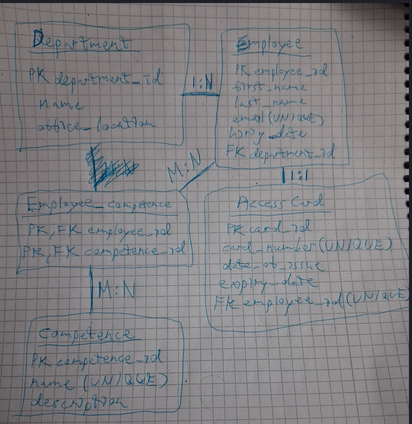

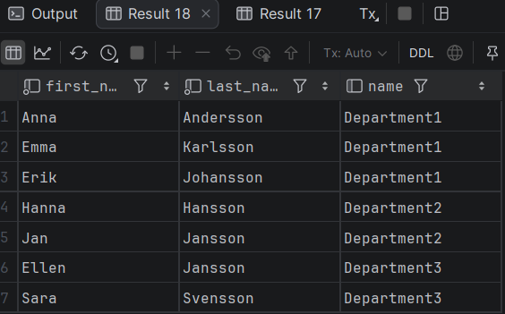
Visar anställdas namn samt avdelning de tillhör. INNER JOIN kopplar tabellerna employee och department via
department_id. Anställda med matchande avdelning visas i resultatet.

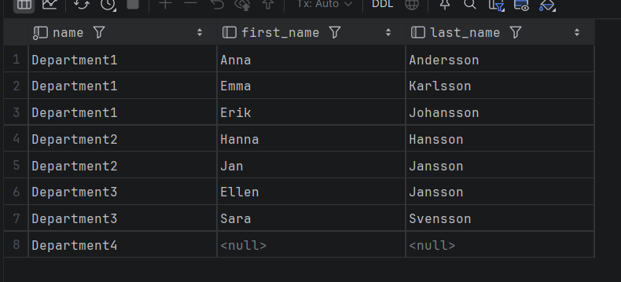
Med LEFT JOIN visas avdelningar som saknar anställda med. För Department4 visas alltså NULL i kolumner för anställde.

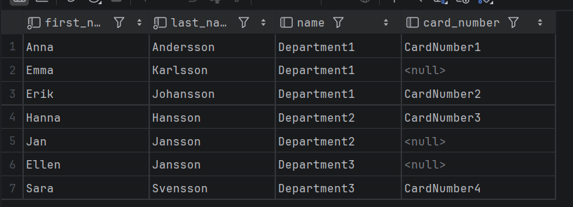
Visar anställdas namn, avdelning de tillhör och eventuellt passerkortsnummer. INNER JOIN kopplar anställda till
avdelningar och LEFT JOIN gör att anställda utan passerkort också visas, men då visas NULL istället för att man ser
vilket passerkort.

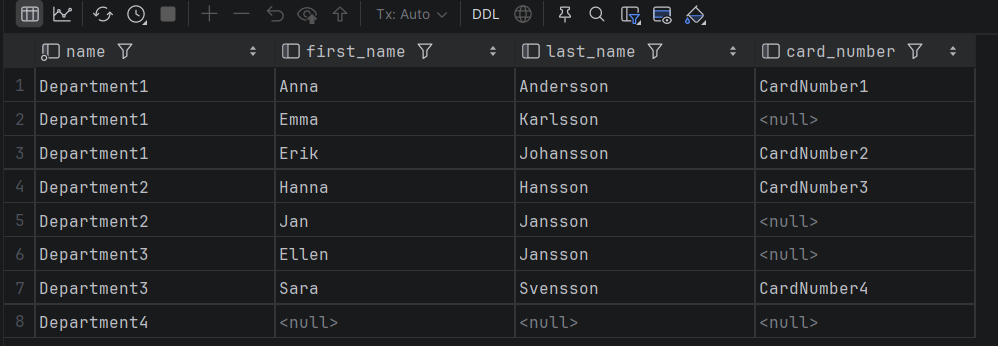
visar avdelningar, de anställda som tillhör avdelning samt eventuellt passerkortsnummer. Med två LEFT JOIN visas också
avdelningar utan anställda och anställda utan passerkort (då visas null).

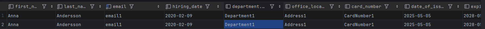
visar information om anställd med employee_id 1. Med LEFT JOIN ser man också uppgifter som saknas. Eftersom anställde
har två kompetenser visas personen på två rader.

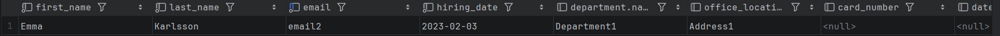
visar information om anställd med employee_id 2. Den saknar passerkort och därför visas NULL.

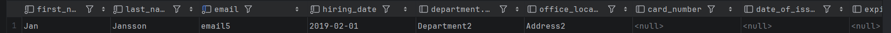
visar information för anställd med employee_id 5. Den saknar passerkort och kompetenser så NULL visas i de kolumnerna.

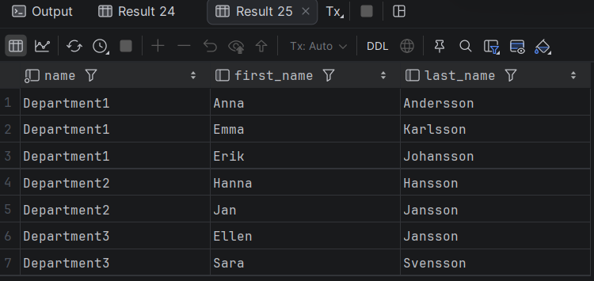
visar avdelningar som har minst en anställd och anställdas namn. INNER JOIN visar bara avdelningar som har en matchande
anställd. Därför försvinner Department4 från resultatet eftersom den saknar anställd.

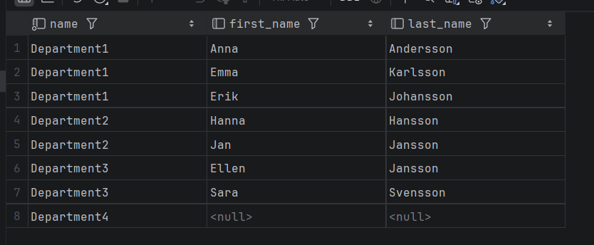
visar avdelningar och anställdas namn. LEFT JOIN visar också avdelningar som inte har anställda. Därför finns
Department4 med.

Bild på resultatet när main körs:
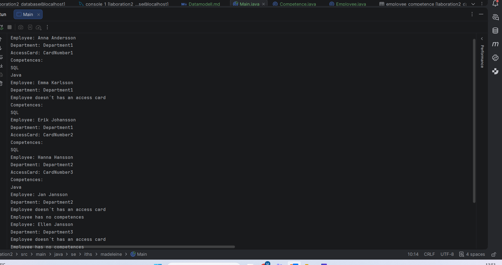

Hur Java-klasserna motsvarar datamodellen:
Jag har gjort klasserna Employee, Department, AccessCard och Competence som motsvarar tabellerna som finns i databasen.
Employee har attributen employeeId, firstName, lastName, email, hiringDate, Department och AccessCard. Department har
departmentId, name och officeLocation. AccessCard har cardId, cardNumber, dateOfIssue och expiryDate. Competence har
competenceId, name och description.

Hur relationerna har representerats i Java: Relationen mellan Employee och Department representeras genom att Employee
har ett Department-objekt så respektive anställd tillhör en avdelning. Relationen mellan Employee och AccessCard
representeras på så sätt att Employee har ett AccessCard-objekt som kan vara null eftersom en anställd inte måste ha ett
passerkort. Relationen mellan Employee och Competence representeras genom en List<Competence> i Employee så att en
anställd kan ha flera kompetenser eller sakna kompetenser.

Hur Java-programmet startas Programmet startas: Man kör mainmetoden i Mainklassen. Då skrivs information om de anställda
ut i konsolen.

